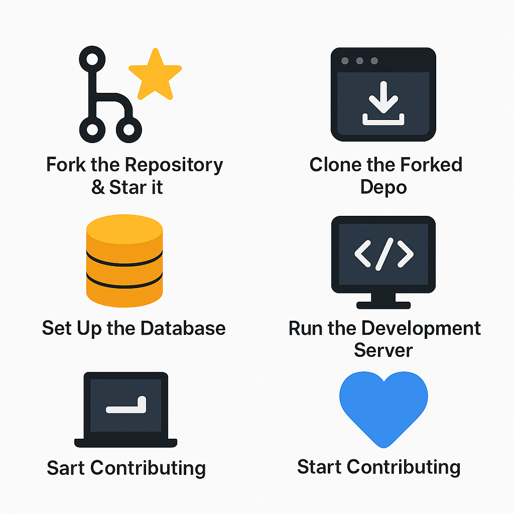

# 🚀 EdgeCareer – AI-Powered Career Coach  


> **Full Stack AI Career Coach built with React 19 + Next.js 15, Tailwind CSS, NeonDB, Prisma, Clerk Authentication, Inngest, Gemini API, and Shadcn UI.**  
> A **cutting-edge AI-driven career platform** that provides **personalized job recommendations, AI resume reviews, and real-time career insights** to help users land their dream job.  


**⚠️ Important for SSoC Contributors (SSoC S4)**

🚨 To be eligible for contribution points in Social Summer of Code (SSoC S4), it is mandatory to install and set up the EntelligenceAI – PR Reviewer extension in VS Code.
🧠 Only those contributors who have properly configured this extension will have their PRs reviewed and counted for SSoC.

✅ This helps us ensure smoother code reviews, automatic tracking, and fair evaluation of all participants.

---

<details>
<summary><strong>Table of Contents</strong></summary>

- [🌟 Key Features](#-key-features)
- [🚀 Tech Stack](#-tech-stack)
  - [Make sure to create a `.env` file with following variables](#make-sure-to-create-a-env-file-with-following-variables--)
- [🧩 Getting Started – Step-by-Step Setup](#-getting-started--step-by-step-setup)
  - [1. Fork the Repository ⭐ & Mark as a Star](#-1-fork-the-repository---mark-as-a-star)
  - [2. Clone the Forked Repo](#-2-clone-the-forked-repo)
  - [3. Install Dependencies](#-3-install-dependencies)
  - [4. Set Up the Database](#-4-set-up-the-database)
  - [5. Run the Development Server](#-5-run-the-development-server)
  - [6. Start Contributing 💙](#-6-start-contributing-)
- [✅Docker Setup](#docker-setup)

<p align="center">
  
</p>


</details>

---

## 🌟 Key Features  

✅ **AI-Powered Resume Builder** – Uses Gemini API for deep insights  
✅ **Secure Authentication** – Implemented with **Clerk**  
✅ **Real-Time Industry Insights** – Managed via **Gemini API**
✅ **AI Powered Cover Letter Gnerator** – Only Enter job Role*One click enough*

✅ **AI-Powered Interview** – Uses Gemini API for deep insights & and find your error give suggestion   

✅ **Interactive UI** – Built with **Shadcn UI & Tailwind CSS**  
✅ **Event-Driven Architecture** – Powered by **Inngest** for async processing  
✅ **Fast & Scalable** – Optimized with **Next.js 15 App Router**  

---

## 🚀 Tech Stack  

| Technology      | Usage |
|---------------|----------------|
| **React 19 & Next.js 15** | Frontend & Server-Side Rendering |
| **Tailwind CSS & Shadcn UI** | Modern UI & Styling |
| **NeonDB & Prisma** | Database & ORM |
| **Clerk Authentication** | Secure login & access control |
| **Inngest** | Background job processing |
| **Gemini API** | AI-powered career guidance |
| **Vercel** | Deployment & hosting |

---
### Make sure to create a `.env` file with following variables -

```
DATABASE_URL=

NEXT_PUBLIC_CLERK_PUBLISHABLE_KEY=
CLERK_SECRET_KEY=

NEXT_PUBLIC_CLERK_SIGN_IN_URL=/sign-in
NEXT_PUBLIC_CLERK_SIGN_UP_URL=/sign-up
NEXT_PUBLIC_CLERK_AFTER_SIGN_IN_URL=/onboarding
NEXT_PUBLIC_CLERK_AFTER_SIGN_UP_URL=/onboarding

GEMINI_API_KEY=
```

---

## 🧩 Getting Started – Step-by-Step Setup

Follow these simple steps to set up **EdgeCareer** locally and start contributing:

---

### ✅ 1. Fork the Repository ⭐ & Mark as a Star  

- Click the **Star** ⭐ button at the top to support the project.
- Then click the **Fork** 🍴 button in the top-right corner to create your own copy of this repository.

This helps you work on the project independently and also motivates the maintainers! 🙌


---

### ✅ 2. Clone the Forked Repo  
Open your terminal and run:

```
git clone https://github.com/your-username/EdgeCareer.git
cd EdgeCareer
```
---

### ✅ 3. Install Dependencies
Install all required packages using:

```
npm install
```
---

### ✅ 4. Set Up the Database
Run Prisma commands to prepare the database:

```
npx prisma generate
npx prisma db push
```

(Optional) Open Prisma Studio to explore your DB:
```
npx prisma studio
```
---

### ✅ 5. Run the Development Server

```
npm run dev
```

---

### ✅ 6. Start Contributing 💙
Browse the issues labeled Beginner, Intermediate, or Advanced

Pick one and start solving!

Make changes, commit, and raise a pull request with a clear message.

---

## Docker Setup✅

**Run the application in a containerized environment using Docker.**


**Prerequisites Docker desktop installed**


1. Build the Docker Image
   and run all this command in terminal :

```bash
 docker build `
   --build-arg NEXT_PUBLIC_CLERK_PUBLISHABLE_KEY=your_pub_key_here `
   --build-arg CLERK_SECRET_KEY=your_secret_key_here `
   --build-arg DATABASE_URL="your_db_url_here" `
   -t your-app-name .
```

2.  Run the Container

```bash
docker run -p 3000:3000 your-app-name
```

Replace 3000:3000 with <host-port>:<container-port> as needed.

---